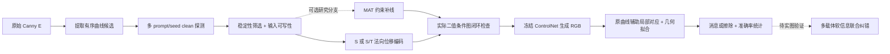
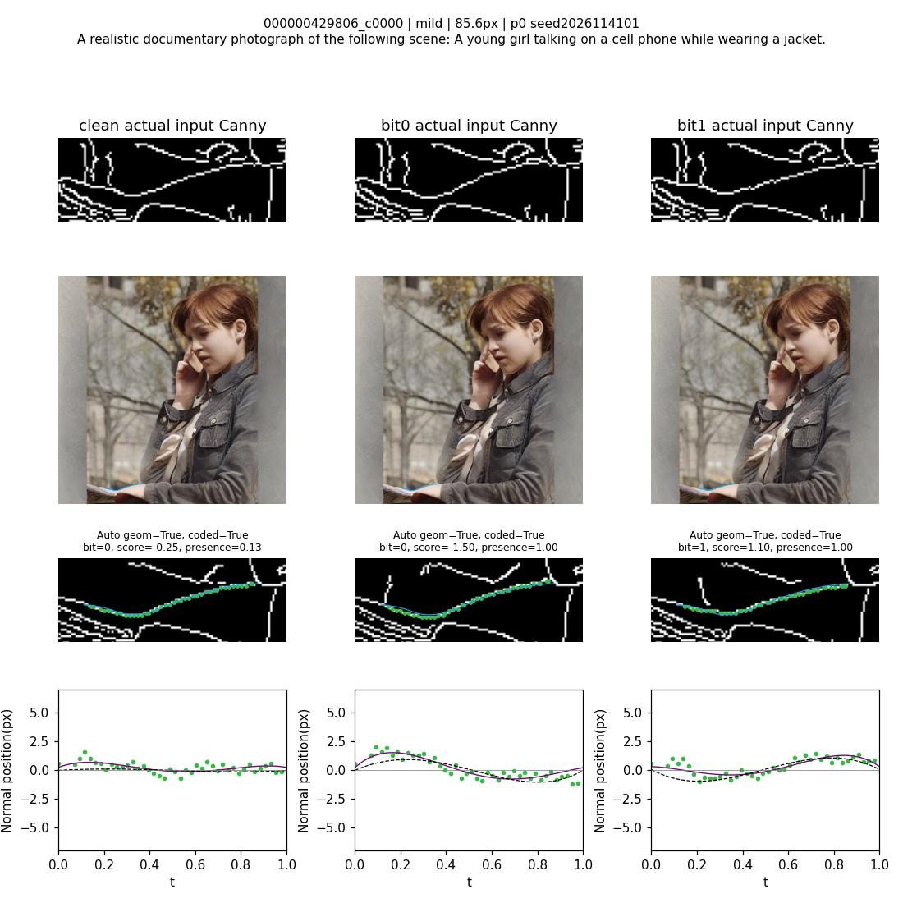

# Canny Geometry Watermark：冻结 ControlNet 的几何消息传输研究

这是截至 **2026-11-12** 的代码整理与审阅包，包含当前 ControlNet 后端、实际实验脚本、轻量几何入口、报告摘录和少量可重放示例。中文说明以审查“是否符合我们的研究目标”为优先。

**当前主目标：把消息写进原始 Canny 的曲线几何，经冻结 ControlNet、不同 prompt/seed 生成 RGB，再从单张 RGB 恢复消息。当前优先评价消息正确率；clean/marked 存在性检测暂不作为主要验收条件。**

当前已验证的是参考辅助下的单曲线 1–2 bit 原型。接收器需要原曲线有序坐标及码本；真正的多曲线消息串、RM/RS 实图纠错和仅凭 Mask 的可靠恢复仍待完成。MAT 是可选的消息约束补线分支。

## 先看哪些内容

| 入口 | 用途 |
|---|---|
| [目标与实现对应](docs/GOAL_ALIGNMENT.md) | A–E 全流程、当前差距、用户最新评估口径 |
| [代码清单](docs/CODE_MAP.md) | 每项任务实际使用的文件、阅读顺序 |
| [实验与指标](docs/EXPERIMENTS.md) | 当前结果、分母、输入闭环与 RGB 结果区别 |
| [运行及复现边界](docs/REPRODUCIBILITY.md) | CPU 演示、GPU 依赖、原脚本历史路径限制 |
| [权重与数据下载](docs/DOWNLOADS.md) | 下载命令、目录、SHA-256、COCO 清单恢复、MAT 单独资产包 |
| [后续实验](docs/ROADMAP.md) | 稳定候选独立验证、多载体、部分缺失、MAT 对照 |
| [第三方来源](THIRD_PARTY_NOTICES.md) | ControlNet、LDM、MAT 和权重的来源与许可证 |

## 方法流程



1 bit：沿原曲线法向叠加 `±1.5*S(t)`，其中 `S(t)=6√3*t*(1-t)*(2t-1)`。原本已弯曲或类似 S 的曲线也按相对位移编码，不按最终是否“像 S”判消息。

2 bit：`aS*S(t)+aT*T(t)`，`T(t)=4*t*(1-t)*(5*(2t-1)^2-1)`，四种符号组合表示 `00/01/10/11`。`|aS|=|aT|≈0.898857 px`，组合连续最大位移≤1.5 px。四码字是调制，不自带纠错冗余。

## 目录

```text
canny_geometry/       可独立运行的几何编码/观测/读码 CLI
configs/             当前 ControlNet 配置、冻结几何阈值
vendor/controlnet/   当前实际使用的 cldm、ldm、ControlNetROBINPipeline
vendor/MAT/          MAT 上游源码及原许可证；无权重
research_snapshot/   原始实验与依赖脚本快照；按原目录关系阅读
evidence/            报告、精简判决与模型/协议元数据
examples/            1 个真实三列示例及稳定筛选对照图
data/coco/           可迁移的normal筛选清单、原筛选配置与来源哈希
docs/                目标、代码清单、实验口径、复现与路线
tools/               完整性检查、CPU 集成验证
provenance/          来源哈希、逐函数提取来源和发布文件清单
```

## CPU 快速查看

建议 Python 3.9；不需要模型权重、CUDA 或原始 COCO 数据。

```bash
python -m pip install -r requirements-cpu.txt
python -m canny_geometry demo --out runs/demo
python -m canny_geometry metrics --out runs/stable_metrics.json
python tools/smoke_check.py
python tools/verify_bundle.py
```

`demo` 对随包真实 RGB 重跑检测，并与原逐图系数、消息和分数核对，包含 clean 对照但不运行存在性门槛。它是一个固定历史示例的重放，不是新增独立验收。



原页面的四行依次为实际条件 Canny、生成 RGB、输出 Canny 与观测、法向位移。蓝线是源曲线；绿点是几何接收通过的观测；黑虚线为输入拟合，紫线为输出拟合。图上的历史 `presence` 字段保留作追溯，当前 CLI 不将其用于消息接收。clean 列的 bit 不表示它被写入了消息。

## 自己的曲线与 RGB

先准备二值 0/255 Canny 和有序曲线坐标 JSON：`{"samples": [[x,y], ...]}`。至少 7 个采样点，整段长度/几何仍需通过实际输入门槛。

```bash
python -m canny_geometry embed --canny examples/conditions/clean.png \
  --curve examples/reference_1bit.json --mode st2 --out runs/st2_conditions
python -m canny_geometry decode --reference examples/reference_1bit.json \
  --rgb examples/rgb/bit1.png --out runs/decoded_bit1.json
```

`embed` 保存全部消息条件图、固定 Mask 和参考码本，检查实际二值图有修改、消息不塌缩且输入能读回。未提供冻结 Cal 模型时使用输入域判决，**只用于检查输入闭环，不能据此宣称新 RGB 已校准**。若需历史 4A 信道模型，可向 `embed` 传入 `--calibration evidence/canny_single_curve_2bit_stage4a_20261111/score_freeze.json`；它不保证适用于新分布。

稳定性探测命令与 GPU 生成见 [复现文档](docs/REPRODUCIBILITY.md)。轻量入口沿用 S/4A 的数值编码与接收函数；4B 联合可辨识性门控、4C 自参考和 MAT 仍以 `research_snapshot/` 为准确实现，未包装成新的统一接收器。

## 当前效果

| 实验 | 完整消息正确率 | 结论范围 |
|---|---:|---|
| S 形 1 bit，Fresh24 | 162/192，84.4% | 源端可写性选择；未加入逐图 clean 稳定探测 |
| S/T 2 bit，Eval12 | 79/96，82.3% | 同上；单曲线四码字，无纠错 |
| 稳定筛选配对：原方法 | 25/48，52.1% | 同一批 6 个既有 Cal 内容、另留出生成条件 |
| 稳定筛选配对：增加稳定筛选 | **36/48，75.0%** | 擦除 14→4；逐 bit 正确恢复 57/96→78/96 |

上述批次协议和内容不同，不能按绝对百分比纵向排名。所有完整恢复率包含擦除；稳定筛选的 75% 仍依赖原曲线参考。完整实验解释见 [实验文档](docs/EXPERIMENTS.md)。

## 当前 ControlNet 与外部资产

使用 **SD1.5 + ControlNet Canny，`control_sd15_canny.pth`，512×512，DDIM20，CFG5，eta0，control scale1，float32**，模型冻结。同 prompt/seed 的各消息共享初始噪声。

实验复用了名为 `ControlNetROBINPipeline` 的封装，但当前 S/S-T 几何链路只调用普通 conditioning/DDIM/VAE 路径，**不调用 ROBIN 潜变量水印注入，也不启用 adapter**。类中其他方法被保留用于来源追溯。

代码压缩包包含源码、报告摘录、少量示例及 COCO 筛选清单，不含模型权重、完整 COCO、历史大量 RGB、虚拟环境或旧 `.git`。下载入口如下，具体命令和校验值见 [权重与数据下载](docs/DOWNLOADS.md)。

| 资产 | 直接下载 / 官方入口 | 放置位置及用途 |
|---|---|---|
| **实际使用的 ControlNet SD1.5 Canny 完整权重**（约 5.71 GB） | [control_sd15_canny.pth](https://huggingface.co/lllyasviel/ControlNet/resolve/main/models/control_sd15_canny.pth) · [发布仓库](https://huggingface.co/lllyasviel/ControlNet) | `models/control_sd15_canny.pth`；主线必需；包含 SD1.5 主干，无需再单独下载 SD1.5 checkpoint |
| **CLIP 文本模型与 tokenizer**（PyTorch 权重约 1.71 GB） | [openai/clip-vit-large-patch14](https://huggingface.co/openai/clip-vit-large-patch14/tree/32bd64288804d66eefd0ccbe215aa642df71cc41) | `models/clip-vit-large-patch14/`；主线必需；下载整个必要文件集合，不能只有权重 |
| **COCO 2017 训练图像**（约 18 GB） | [train2017.zip](http://images.cocodataset.org/zips/train2017.zip) · [COCO 官方下载页](https://cocodataset.org/#download) | `datasets/coco/train2017/`；原主实验使用 train2017 |
| **COCO 2017 captions / instances 标注**（约 241 MB） | [annotations_trainval2017.zip](http://images.cocodataset.org/annotations/annotations_trainval2017.zip) | `datasets/coco/annotations/`；prompt 来源与 MAT 数据准备 |
| COCO 2017 验证图像（约 1 GB，可选） | [val2017.zip](http://images.cocodataset.org/zips/val2017.zip) | `datasets/coco/val2017/`；MAT 历史数据准备等可选分支 |
| **MAT 实际使用的 Places512 转换权重**（约 251 MB，可选） | [Places_512_FullData_G.pth](https://github.com/Sanster/models/releases/download/add_mat/Places_512_FullData_G.pth) | `fuxian_papers/checkpoints/mat/Places_512_FullData_G.pth`；IOPaint 发布版本，匹配当前 `use_noise=False` 架构 |
| MAT 原作者模型（可选） | [原作者下载入口及说明](https://github.com/fenglinglwb/MAT#quick-test) | 原生 `.pkl`；与上行 `.pth` 格式不同，不能直接改名替代 |

**本地训练的 MAT 领域权重没有已确认的公开下载地址。** 本次另附 `canny-geometry-mat-domain-weights_20261112.zip`，包含消息实验用到的四个 checkpoint、原始协议、阈值与校验清单；它是独立资产包，不在代码 ZIP 内。可作为 GitHub Release 附件分发，发布后再补实际 URL，不虚构已发布地址。

为避免重新筛选导致内容变化，代码包新增 `data/coco/normal_manifest.csv.gz`：保留原 **94,625** 条 normal 内容的顺序、prompt 和统计，仅将机器绝对图像路径转为 `train2017/<file_name>`。按下载文档用 `tools/restore_coco_manifest.py` 映射到新机器。下载 COCO 原图本身不会自动得到这份实验筛选清单。

上述地址来自上游仓库和本机保留的来源记录；当前环境 DNS 受限，本次未在线确认可访问性或重新下载大文件。历史实验冻结清单仍有外部产物依赖，不能将代码包误认为全部原实验资产的镜像。

## 上传 GitHub

将本文件夹作为仓库根目录；不要再套原 ControlNet 工作区。

```bash
git init
git add .
git commit -m "Add Canny geometry message research snapshot"
git branch -M main
git remote add origin https://github.com/YOUR_ACCOUNT/YOUR_REPOSITORY.git
git push -u origin main
```

本次仅整理本地目录与 ZIP，没有创建远程仓库或上传。打包文件清单和 SHA-256 校验记录见 `provenance/`。根目录保留原 ControlNet Apache-2.0 文本；MAT 保留其独立的 CC BY-NC 4.0 许可，详见 [第三方说明](THIRD_PARTY_NOTICES.md)。
