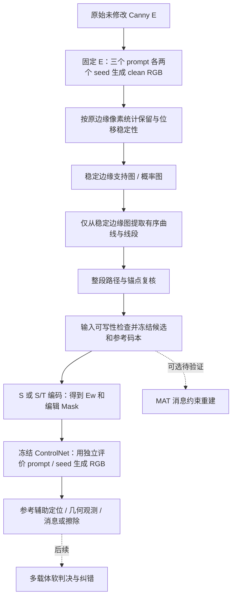

# Canny 几何消息传输：精简研究实现

目标：将消息写入原始 Canny 的稳定曲线几何，经冻结的 SD1.5 ControlNet、不同 prompt/seed 生成 RGB，再从单张 RGB 恢复消息。当前接收器需要**原曲线有序坐标、参数化及码本**；仅 Mask 恢复、多载体 RM/RS 实图纠错仍待完成。

本版移除历史脚本快照、ROBIN/FFT/adapter、无关训练/评估入口；保留普通 ControlNet 推理依赖、几何主线、可选 MAT 普通修复入口、必要证据及复现数据清单。模型权重和完整 COCO 单独下载。

## 流程：先探测与筛选区域，再提取候选



`probe` 已按上述顺序实现，并保存稳定支持图和统计；不会先在完整 E 上选曲线。稳定支持图是筛选结果；编码 Mask 是随后围绕选中曲线建立的编辑区域，两者用途不同。

初筛使用距输出边缘≤3px、至少5/6次支持、每prompt至少1次、位移离散度≤2px；然后才提取曲线、复核整段匹配与输入可写性。近邻支持不能保证语义对应，新流程的固定内容评测及重复验证见下方报告。详见 [目标与边界](docs/GOAL_ALIGNMENT.md)。

## 快速运行

建议 Python3.9。CPU 演示无需权重、CUDA、COCO：

```bash
python -m pip install -r requirements-cpu.txt
python -m canny_geometry demo --out runs/demo
python -m canny_geometry metrics --out runs/stable_metrics.json
python tools/smoke_check.py
python tools/check_stability.py
python tools/verify_bundle.py
```

完整操作见 [运行与复现](docs/REPRODUCIBILITY.md)：`probe-generate → probe → select → generate → decode`。低层 `embed` 可用于已知曲线的编码诊断；它不代替稳定筛选。每次生成使用新输出目录。

1 bit 沿原曲线法向叠加 `±1.5*S(t)`，`S(t)=6√3*t*(1-t)*(2t-1)`。2 bit 使用 S/T 两个基函数的四种符号组合，联合最大位移≤1.5px。原曲线已有 S 形时仍编码相对位移。四个符号是调制，尚无纠错冗余。


四行依次为条件图、RGB、输出边缘与局部对应、法向位移。三列为clean、bit0、bit1。当前不使用图中历史presence门槛判消息；clean只作配对对照。

## 已有结果与复现范围

| 实验 | 完整消息正确率 | 范围 |
|---|---:|---|
| S 1bit Fresh24 | 162/192=84.4% | 单曲线，源端可写选择 |
| S/T 2bit Eval12 | 79/96=82.3% | 单曲线四符号 |
| 旧稳定筛选配对 | 25/48→36/48=75.0% | 六个既有Cal内容，旧流程先提曲线再筛选 |
| 新区域先筛选 Eval12 | 74/96=77.1% | 新6 Cal+12 Eval，完整独立重复通过 |

**75%不属于本版新“区域先筛选”流程。** 新流程已另行生成独立评价RGB并统计可编码率与消息恢复率，见验收报告；不能把更换选择顺序当作已有提升。不同历史批次也不能直接纵向排名。

整批评测现有独立入口与相对路径输入：历史748张RGB的生成计划、732行解码、576条质量核对及4A校准重建；新“区域先筛选”另立6 Cal +12 Eval协议，并从原始Canny重复运行。实测结果与范围见 [复现验收](docs/REPRODUCTION_RESULT.md)；命令见 [整批复现](docs/REPRODUCIBILITY.md)。`metrics`仍只是历史判决汇总。

## 下载与目录

完整下载命令、SHA-256和COCO清单恢复见 [DOWNLOADS](docs/DOWNLOADS.md)。

| 资产 | 下载入口 |
|---|---|
| ControlNet SD1.5 Canny完整权重 | [control_sd15_canny.pth](https://huggingface.co/lllyasviel/ControlNet/resolve/main/models/control_sd15_canny.pth) |
| CLIP文本模型/tokenizer | [固定版本](https://huggingface.co/openai/clip-vit-large-patch14/tree/32bd64288804d66eefd0ccbe215aa642df71cc41) |
| COCO训练图像 | [train2017.zip](http://images.cocodataset.org/zips/train2017.zip) |
| COCO标注 | [annotations_trainval2017.zip](http://images.cocodataset.org/annotations/annotations_trainval2017.zip) |
| MAT领域权重：四checkpoint+原协议/阈值 | [项目Release ZIP](https://github.com/FBW-JNU/Controlnet_canny_watemark/releases/download/mat-weights/canny-geometry-mat-domain-weights.zip) |
| MAT基础权重：可选初始化 | [Places_512_FullData_G.pth](https://github.com/Sanster/models/releases/download/add_mat/Places_512_FullData_G.pth) |

```text
canny_geometry/       探测、稳定筛选、选曲线、编码、普通ControlNet生成、解码；可选MAT修复
vendor/controlnet/   当前配置所需的cldm/ldm源码与许可证
vendor/MAT/          可选MAT推理依赖及原许可证
configs/             网络配置、几何阈值
examples/            少量历史输入/RGB/参考与面板
evidence/           少量历史汇总、校准和逐图判决
data/coco/          94,625行normal总体清单与来源（无照片）
benchmarks/         历史最小输入闭包、新流程原始Canny/协议/冻结计划与金标准
docs/               方法、代码、结果、复现和下载说明
tools/              检查、清单恢复和打包
provenance/         来源、校验、验证与本次删除清单
```

[代码地图](docs/CODE_MAP.md) · [实验解释](docs/EXPERIMENTS.md) · [后续实验](docs/ROADMAP.md) · [许可证与来源](THIRD_PARTY_NOTICES.md)

## 更新已有 GitHub 仓库

本次只改本地交付目录及代码ZIP，没有推送。**网页覆盖上传不会自动删除旧文件**。上传本包新增/修改文件；本次未重新引入research_snapshot或ROBIN。更新方法见 [更新说明](docs/UPDATE_GITHUB.md)。MAT Release独立ZIP保持原样，无需重新上传。
