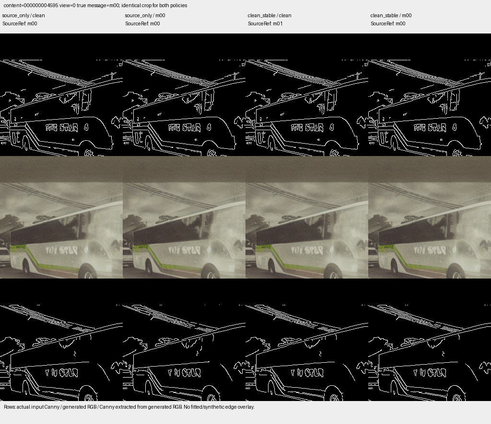

# 现有实验、指标与解释范围

整理日期：2026-11-12。以下数字来自已有真实结果，历史批次数字保留作基线。本次冻结批次复现和新区域先筛选的独立评价另见[复现验收](REPRODUCTION_RESULT.md)；下表中的旧75%不属于新流程。

## 当前消息主指标

| 结果 | 定义 |
|---|---|
| 正确消息 | 所有位都与真实写入相同 |
| 错误消息 | 已接收并判出消息，但至少一位错误 |
| 擦除 | 未获得可信几何/码本/拟合，输出消息为空 |
| 完整恢复率 | 正确 / (正确+错误+擦除) |
| 逐bit正确恢复率 | 正确位 / 全部写入位，擦除位未恢复 |
| 已接收BER | 错误位 / 已接收位；必须同时报告擦除 |

clean无真实消息；目标均衡随机时逐bit无关联基线50%，2bit整词25%。不能把没有观测的样本随机补位后当成可靠接收。若以后采用强制判决，应冻结回退规则并单独报告结果。

## 稳定载体筛选配对实验

证据：[汇总](../evidence/canny_st_stable_carrier_compare_20261111/summary.json)及随包逐图判决。该旧实验先提曲线，再筛曲线稳定性；与本版先筛边缘区域的顺序不同。

6个既有Cal内容，每个3prompt×2seed生成6张clean探测，共36张。候选需匹配≥5/6、每prompt≥1/2、锚点合格≥5/6、成功匹配距离中位数≤3px。按源长度选择第一个通过原九状态准入的曲线。评价prompt/seed与探测无交集，两策略共享初始噪声，选择在评价生成前冻结。

| 指标 | source_only | clean_stable |
|---|---:|---:|
| 完整2bit恢复 | 25/48=52.1% | 36/48=75.0% |
| 错误/擦除消息 | 9/14 | 8/4 |
| 正确位/全部96位 | 57/96=59.4% | 78/96=81.3% |
| 已接收错误位/已接收位 | 11/68=16.2% | 10/88=11.4% |
| 质量四项联合通过 | 43/48 | 44/48 |
| 消息正确且质量通过 | 23/48 | 33/48 |
| 留出clean严格路径匹配 | 4/12 | 10/12 |

恢复改善主要伴随擦除减少，已接收错误仍存在。按6个内容配对bootstrap完整恢复增益区间约+4.2至+47.9个百分点；小型开发集不能支撑强泛化保证。75%是原曲线参考辅助；同批管道Mask自参考22/48=45.8%，矩形Mask18/48=37.5%。

`python -m canny_geometry metrics` 从随包120条精简记录重算，包含clean但不赋予其消息真值。clean_stable/SourceRef的12张clean判决为9个01和3个00，不是均匀随机输出。

四列依次为原方法clean、原方法marked、稳定筛选clean、稳定筛选marked；三行为实际输入Canny、生成RGB、输出Canny。同一原图可能在两个策略中选了不同位置/长度的曲线。

## 其他已完成实验

| 实验 | 结果 | 解释 |
|---|---|---|
| Stage1 Train32 | 384 clean RGB；3488候选选1192，留出曲线匹配78.3% | 自然轮廓稳定性，不是消息容量 |
| S 1bit Fresh24 | 162/192正确，8错22擦除；质量185/192 | 未用新内容的clean探测筛载体；95%内容bootstrap约75–91.7% |
| S/T 2bit Eval12 | 79/96完整正确，5错12擦除；质量92/96 | 单曲线四符号；95%内容bootstrap约69.8–92.7% |
| 4B Fresh12 | 无缺失25/48；随机删25%为24/48；中央删25%全擦除 | 控制对应后拟合与删边重匹配必须分开；全擦除也可能由门槛导致 |
| 4C去参考 | 原参考25/48，管道16/48，矩形21/48，全图5/48 | 几何参考依赖明显；更换接收器不能偷称同条件提升 |
| Cal幅度扫描 | 参考辅助1.5px29/48，2px26/48，3px25/48，4px20/48 | 放大位移没有自动改善，质量也下降；仅6 Cal内容诊断 |
| 离线重复/RM | 符号模拟已实现 | 未生成真实8载体RGB；重复码1bit与RM4bit载荷不同 |

各批内容/生成条件/门槛不同，不能拿82.3%与75%作严格容量或算法排名。旧Stage2若干目录缺失，当前名单只能排除可核验历史内容，不能补称完整历史无重叠。

## MAT分支尚未得到RGB验证

二值V2 G3投影前34/40、投影后35/40；直接编辑G4为40/40。soft native/refined G3投影后35/40、34/40，未显示一致改善。原G3全40输入闭环门槛未过，所以按原计划跳过扩散。本包仅保留二值V2汇总`evidence/mat_st_message_experiment1_20261111/constraints_v2/summary.json`；其他诊断源码/证据已精简，原工作区仍在。

投影显式用源曲线重建码字，部分成功支撑只来自孔外，不能把投影后可读率全部归因于MAT。需要先解决真实孔内支撑、细线连续性与输入闭环，再谈RGB恢复率。

## 质量与审计

固定质量条件：配对同噪声clean的PSNR≥30dB、SSIM≥0.90、LPIPS≤0.10、3×3容差Edge-F1≥0.95。质量未通过的样本仍在消息分母。存在性检测暂不作为主目标，并不等于取消质量约束。

历史审计通过表示当时文件/冻结顺序核验成功，不等于所有研究目标或质量门槛通过。旧evidence中的工作区绝对路径被替换为`${ORIGINAL_WORKSPACE}`，原文件哈希另存provenance；这些JSON是可审阅元数据，不是可在新目录无条件执行的原冻结清单。
